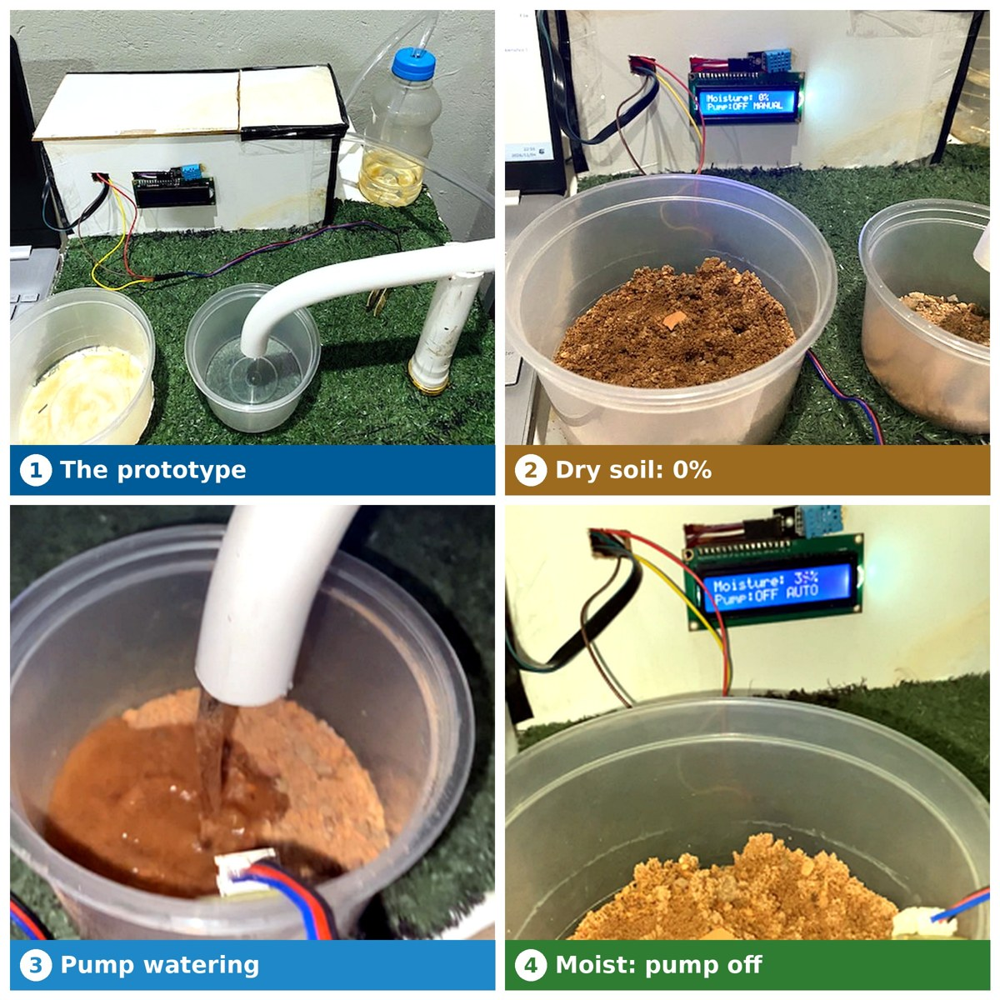
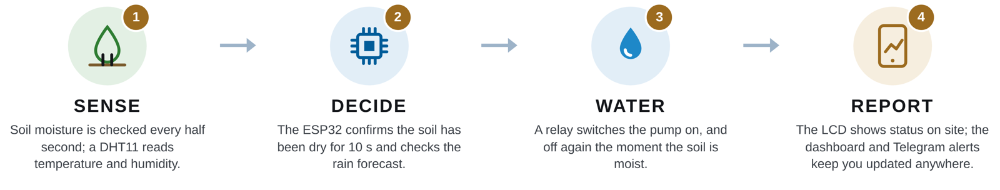
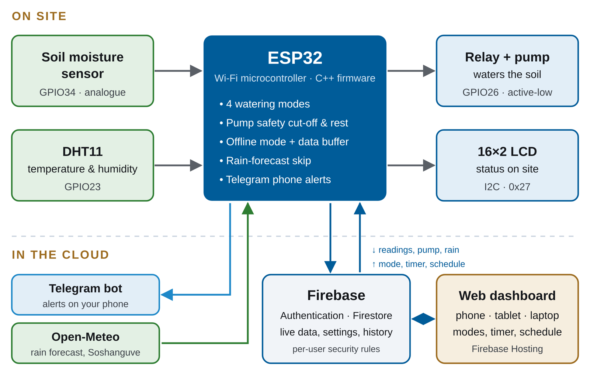
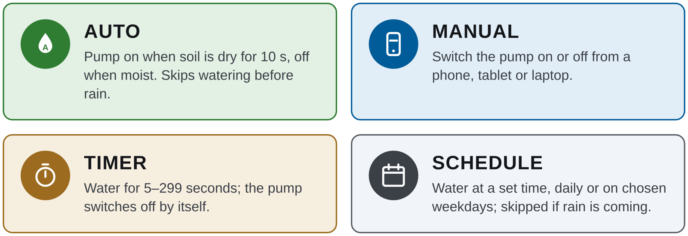
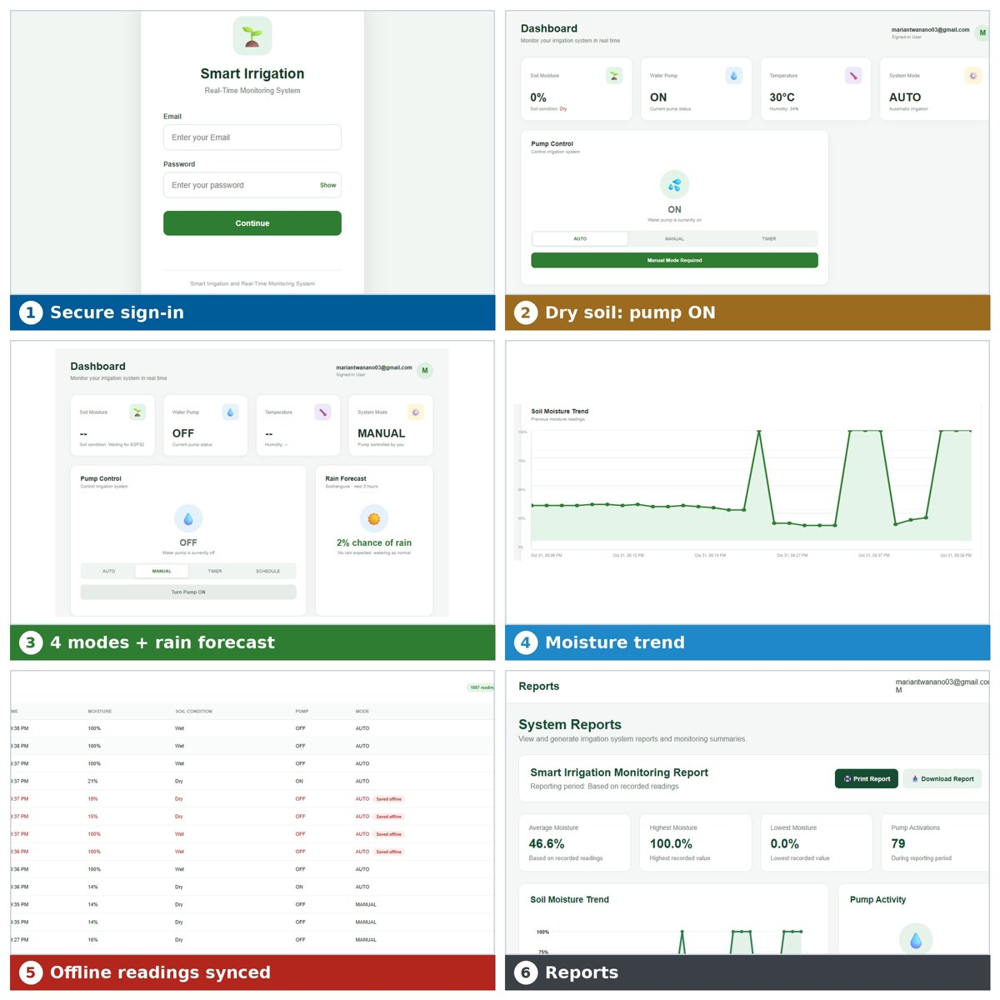

# Smart Irrigation System and Real-Time Monitoring

A low-cost ESP32 system that senses the soil, waters only when the plants need it, skips watering when rain is forecast, sends alerts to your phone, and lets you monitor and control everything from any device, even when the Wi-Fi drops.

Built as a Computer Systems Engineering project at Tshwane University of Technology.



## Features

- **Four watering modes:** AUTO (waters when the soil is dry), MANUAL (pump button on the dashboard), TIMER (5–299 s countdown) and SCHEDULE (set time, daily or chosen weekdays).
- **Works offline:** if the dashboard can't be reached for 20 s, the ESP32 switches to offline AUTO. Up to 120 readings are stored with their real time and uploaded when Wi-Fi returns.
- **Rain-forecast skip:** every 30 minutes the ESP32 checks the [Open-Meteo](https://open-meteo.com/) forecast and skips AUTO and SCHEDULE watering when rain is likely (60% or more in the next 3 hours).
- **Telegram alerts:** pump on/off, safety stops, rain expected and back-online messages arrive on your phone.
- **Live web dashboard:** soil moisture, temperature, humidity, pump state, mode controls, rain forecast, history and reports, from any phone or laptop.
- **Built-in safety:** 10 s of dry readings before the pump starts, a 5-minute maximum run with a 2-minute rest, and a lock if the sensor reads nothing after 60 s of watering.
- **Secure data:** Firestore security rules let only the owner change settings and only the device write sensor data.

## How it works





The ESP32 makes every pump decision itself, so watering never depends on the internet. Firebase only stores and shares the data: the dashboard writes requests (mode, timer, schedule) and the ESP32 writes back what really happened.



## Dashboard



## Hardware

| Part | Connection |
|---|---|
| ESP32 Dev Module | Main controller (Wi-Fi) |
| Soil moisture sensor (analogue) | GPIO34 |
| DHT11 temperature and humidity sensor | GPIO23 |
| 5 V relay module (active-low) + small DC pump | GPIO26 |
| 16×2 LCD with I2C backpack (address 0x27) | SDA GPIO21, SCL GPIO22 |
| BOOT button | GPIO0 (switches Wi-Fi off and on for demos) |

## Tech stack

- **Firmware:** C++ (Arduino framework) on the ESP32
- **Cloud:** Firebase Authentication, Cloud Firestore, Firebase Hosting
- **Web:** HTML, CSS, JavaScript (Firebase Web SDK)
- **APIs:** Telegram Bot API, Open-Meteo weather API

## Project structure

```
firmware/smart_irrigation/   ESP32 sketch
web/                         Dashboard website (Firebase Hosting)
firestore.rules              Firestore security rules
docs/images/                 Photos and diagrams for this README
```

## Setup

### Firmware

1. Install the **ESP32** board package in the Arduino IDE.
2. Install these libraries from the Library Manager: **FirebaseClient** (Mobizt), **ArduinoJson**, **LiquidCrystal I2C**, **DHT sensor library** (Adafruit).
3. Open `firmware/smart_irrigation/smart_irrigation.ino` and fill in the placeholders in sections 1 and 1.2: Wi-Fi name and password, Firebase API key, the device account's email and password, and your Telegram bot token and chat ID.
4. Select **ESP32 Dev Module**, then upload.

Optional switches in the sketch: `ENABLE_TELEGRAM`, `ENABLE_RAIN_SKIP`, and `RAIN_TEST_MODE` (pretends rain is coming, for demos).

### Web dashboard

1. Create a Firebase project with Authentication (email/password) and Cloud Firestore.
2. Put your project's web config in `web/firebase-config.js`.
3. Publish `firestore.rules` in the Firebase Console (Firestore Database → Rules), with your own owner and device user IDs.
4. Deploy the `web` folder with Firebase Hosting.

## Future improvements

- Water-level sensor to stop the pump when the tank is empty
- Capacitive soil sensor that can tell dry soil apart from air
- Multiple watering zones from one unit
- Mobile app, and Telegram commands to switch the pump by message
- Solar power and a flow meter to report litres saved

## Author

**Maria Ntwanano Ngobeni**, Diploma in Computer Systems Engineering, Tshwane University of Technology
